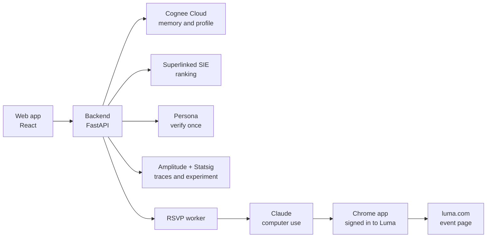

# Event Agent

A personal agent that finds San Francisco events you'll like and registers you for them on Luma, in a real browser, while you do something else. It remembers what you're into, explains every pick, fills in the registration form from your profile, and shows you each step it took.

**Demo video:** https://drive.google.com/file/d/1muUDG55v4M-1oesn_gOgEtM4IN8kY6xu/view?usp=sharing

Built in one day at the [Personal Agents Hackathon](https://tokensand.com/personalagenthack) (tokens&, San Francisco, November 20, 2026).

## The problem

Finding events is easy. Getting into them is tedious: you open each page, sign in, fill out the same name, company and LinkedIn fields again, write a "why do you want to attend" answer, and then check whether it worked. Event Agent does that part for you, and keeps a record of what it did.

## What it does

1. **Verify once.** You sign in with your email and verify your identity with Persona (ID photo and selfie). The agent only acts for a verified person.
2. **Tell it what you're into.** "AI agents and hackathons lately." It saves that to memory (Cognee), along with an About you profile: job, company, school, links and a short bio.
3. **For you.** It ranks 38 real upcoming SF events from Luma and gives a one-line reason for each pick, quoted from what it remembers about you. You can also ask in plain words: "Agent hackathons next week, evenings or weekend, not too big."
4. **Tap RSVP.** Claude takes over a real Chrome window that's signed in to your Luma account. It checks the event, fills in every field from your profile, writes short answers to open-ended questions, clicks Luma's own register button, and reads your status back from the page.
5. **See what happened.** The RSVP screen shows the five steps live, and you can watch the agent's screen. Afterwards, "What the agent did" lists every action with its cost against a $2 daily limit.

If Luma emails you a login code mid-run, the app asks you for it and the agent carries on. It hands the run back to you only for payment, a captcha, or an electronic signature.

## How it meets the challenge

The challenge asked for an agent that uses reliable context to make decisions, takes a meaningful action, and shows the information and steps behind what it did.

| The challenge asks for | Event Agent |
| --- | --- |
| Reliable context | Your preferences, history and profile live in Cognee. Every pick's reason quotes a stored fact, and you can see or forget any of them. |
| A meaningful action | A real registration on luma.com, done by Claude in a real browser, not an API shortcut |
| The steps behind it | Five live RSVP steps, the agent's screen, an activity log with costs, and every Claude call traced in Amplitude |

## Sponsor tools

| Sponsor | What it does in Event Agent |
| --- | --- |
| [Cognee](https://www.cognee.ai) (Cloud) | Long-term memory: what you said, went to and skipped, plus your About you profile. Recall powers the "why this pick" lines and the form filling. Forget removes a fact at once. |
| [Superlinked](https://superlinked.com) (SIE Serverless) | Embeds every event and your taste (Qwen3-Embedding-4B), then reranks the top 40 (Qwen3-Reranker-4B). |
| [Statsig](https://statsig.com) | Experiment `ranking` splits users 50/50 between the old ranking (TF-IDF word matching) and the new one (Superlinked plus memory). |
| [Amplitude](https://amplitude.com) | Agent analytics: every Claude call is traced with `amplitude-ai`, and each RSVP is one session. Funnel events from picks to RSVPs, grouped by ranking arm. |
| [Persona](https://withpersona.com) | Verify once (sandbox ID and selfie). The agent won't RSVP for anyone who isn't verified. |
| [Anthropic](https://www.anthropic.com) Claude | Computer use drives the Chrome window and fills the forms. Claude also tags events, reads what you're into and parses Ask queries. |

## How it works



The backend talks to each sponsor through its own small module, and each module has a fake, so the whole app runs with no keys. RSVPs run as background jobs, so you can close the app mid-run.

The RSVP agent has five steps:

1. **Check the event:** free, spots left or a waitlist. It reads Luma's own page data first and only asks Claude when the page is unclear.
2. **Open the event page** in a new tab of the Chrome app, signed in as you. You sign in to Luma there once, yourself.
3. **Fill in the form:** Claude gets your profile and memories from Cognee and fills every field.
4. **Register:** Luma's own button (Register, RSVP, Accept Invite, or Join Waitlist when the event is full).
5. **Check it worked:** it reads "You're going" or "Pending approval" back from the page.

## What it won't do

- Pay for anything, or type card details.
- Solve a captcha or "verify you are human" check.
- Sign anything: an electronic signature always comes back to you.
- Invent facts about you. Form answers come only from your profile and memories, and a question with no basis gets a neutral true answer.
- Spend past your daily limit ($2 by default).

One honest note: Luma's form has no field for a note to the host, so the host sees a normal registration from your account. The agent doesn't message hosts.

## Screens

Sign in, Verify once, Connect your sites, Into right now, Your week, For you, Ask, Event, RSVP progress, Needs you, You're going, What the agent did, What the agent remembers, Profile (with About you), and a team dashboard at `/ops`.

## Run it

You need Python 3.11, Node 20 and Google Chrome.

```
cp .env.example backend/.env
cd backend
uv venv --python 3.11 .venv && uv pip install --python .venv/bin/python -r requirements.txt
.venv/bin/python -m playwright install chromium
.venv/bin/uvicorn app.main:app --port 8000

# second terminal
cd web && npm install && npm run dev      # open http://localhost:5173
```

With no keys, every sponsor runs on a fake and RSVPs are simulated, so you can click through the whole app. Add `?mock=1` to the URL to use the design's sample data. [SETUP.md](SETUP.md) explains how to turn on each sponsor for real, sign the agent's Chrome in to Luma, and fill the dashboards.

Tests: `cd backend && .venv/bin/python -m pytest -q` (207 pass).

## Repo map

```
backend/app/
  main.py, worker.py, store.py     API, background RSVP runs, SQLite
  contracts.py                     shared shapes and interfaces
  feed.py                          For you, Ask, and "why this pick"
  act/                             the RSVP agent: Chrome app + Claude computer use
  sponsors/memory|ranking|identity|telemetry/   Cognee, Superlinked, Persona, Amplitude + Statsig
  extra/                           sign-in, sites, calendar, week, activity, ops
  catalog/                         the 38 Luma events, the Luma page reader, text jobs
web/src/                           the React app
data/events.json                   real upcoming SF events from Luma
evals/                             replays the demo for 20 synthetic users
design/                            the design canvas's screens and tokens
```

## Known limits

- Luma is the only site the agent can register on today. Partiful, Meetup and Eventbrite appear on the Connect screen, but connecting them only records the choice.
- There's no email provider yet, so the sign-in code is shown on screen.
- The sign-in cookie holds the user id unsigned. That's fine for a demo, not for real users.
- Statsig computes experiment results daily, so its Diagnostics tab is the live view during the hackathon.

## Team

Arjun Varshney
